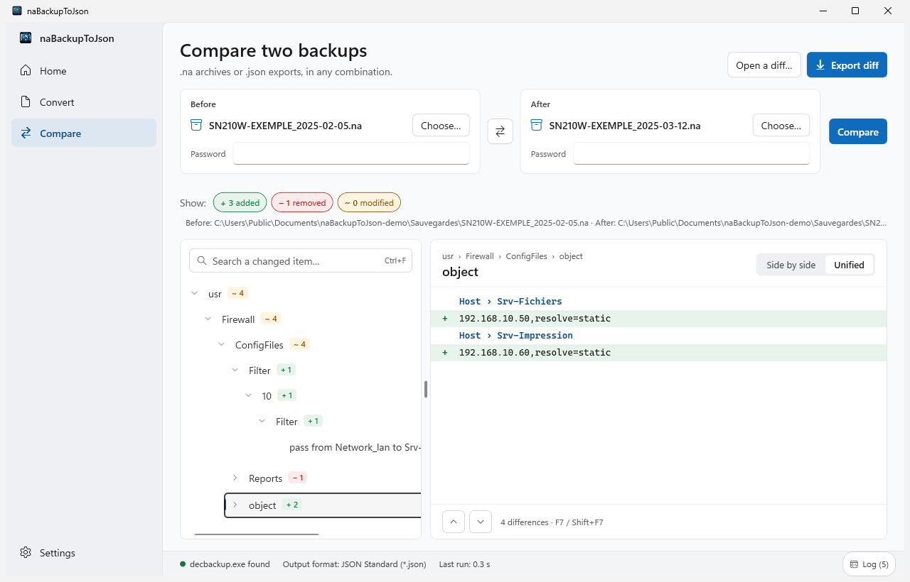
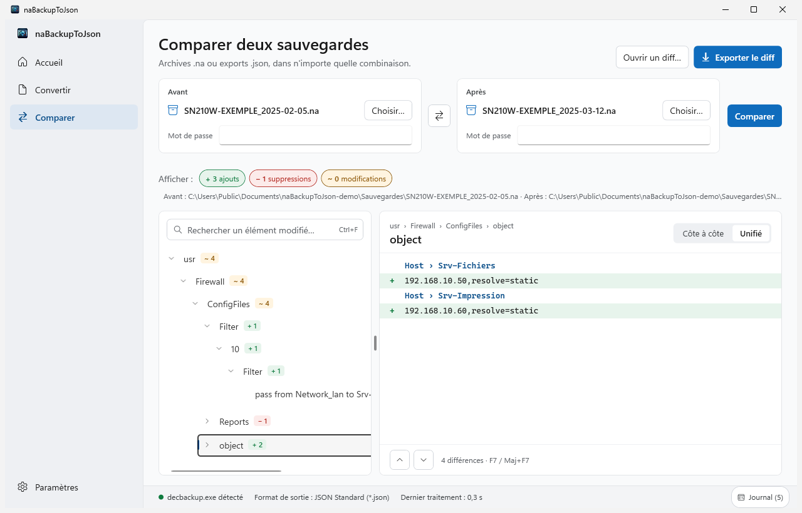

# NABACKUPTOJSON

**[English](#english)** | **[Français](#francais)**

---

## 🇬🇧 English

### Overview

naBackupToJson is a Windows application for working with configuration backups of Stormshield Network Security (SNS) firewalls.

The application allows you to:

- **Convert** a configuration backup (`.na` file) into a single, structured JSON file,
- **Explore** the content of a backup before exporting it: tree, search, filters by type and reading of configuration files,
- **Compare** two backups and identify the items added, removed and modified,
- **Automate** conversion and comparison from the command line.

> [!IMPORTANT]
> Backups are processed only on the workstation. No data is sent over the network and passwords are never saved.

### System requirements

| Item | Description |
| :--- | :--- |
| Operating system | Windows 10 or Windows 11, 64-bit. |
| .NET | [.NET 10 Desktop Runtime (x64)](https://dotnet.microsoft.com/download/dotnet/10.0) for the graphical application. The command-line tool runs without any .NET installation. |
| decbackup.exe | Tool that decodes `.na` backups. It is not included with the application. |

### Installation

naBackupToJson is available in two forms, on the repository **Releases** page:

| File | Description |
| :--- | :--- |
| `naBackupToJson-<version>-setup-win-x64.exe` | Installer. Installing for the current user does not require administrator rights. |
| `naBackupToJson-<version>-portable-win-x64.zip` | Portable version. Settings are saved in the application folder, for example on a USB drive. |

To install and use naBackupToJson:

1. Run the installer, or extract the portable version into a writable folder,
2. Copy your `decbackup.exe` into the application folder, or set its location in **Settings** > **Path to decbackup.exe**,
3. Start naBackupToJson,
4. Drop a `.na` backup on the window, then click **Convert**.

> [!NOTE]
> If naBackupToJson is already installed, the installer offers to update, uninstall or cancel.

---

## 🇫🇷 Français

### Présentation

naBackupToJson est une application Windows destinée à l'exploitation des sauvegardes de configuration des firewalls Stormshield Network Security (SNS).

L'application permet de :

- **Convertir** une sauvegarde de configuration (fichier `.na`) en un fichier JSON unique et structuré,
- **Explorer** le contenu d'une sauvegarde avant de l'exporter : arborescence, recherche, filtres par type et lecture des fichiers de configuration,
- **Comparer** deux sauvegardes et identifier les éléments ajoutés, supprimés et modifiés,
- **Automatiser** la conversion et la comparaison en ligne de commande.

> [!IMPORTANT]
> Les sauvegardes sont traitées exclusivement sur le poste de travail. Aucune donnée n'est transmise sur le réseau et les mots de passe ne sont jamais enregistrés.

### Configuration requise

| Élément | Description |
| :--- | :--- |
| Système d'exploitation | Windows 10 ou Windows 11, 64 bits. |
| .NET | [.NET 10 Desktop Runtime (x64)](https://dotnet.microsoft.com/download/dotnet/10.0) pour l'application graphique. L'outil en ligne de commande fonctionne sans installation de .NET. |
| decbackup.exe | Outil de décodage des sauvegardes `.na`. Il n'est pas fourni avec l'application. |

### Installation

naBackupToJson est disponible sous deux formes, dans la page **Releases** du dépôt :

| Fichier | Description |
| :--- | :--- |
| `naBackupToJson-<version>-setup-win-x64.exe` | Installateur. L'installation pour l'utilisateur courant ne nécessite pas de droits d'administration. |
| `naBackupToJson-<version>-portable-win-x64.zip` | Version portable. Les réglages sont enregistrés dans le dossier de l'application, par exemple sur une clé USB. |

Pour installer et utiliser naBackupToJson :

1. Lancez l'installateur, ou décompressez la version portable dans un dossier accessible en écriture,
2. Copiez votre `decbackup.exe` dans le dossier de l'application, ou indiquez son emplacement dans **Paramètres** > **Chemin de decbackup.exe**,
3. Lancez naBackupToJson,
4. Déposez une sauvegarde `.na` sur la fenêtre, puis cliquez sur **Convertir**.

> [!NOTE]
> Si naBackupToJson est déjà installé, l'installateur propose de mettre à jour, de désinstaller ou d'annuler.